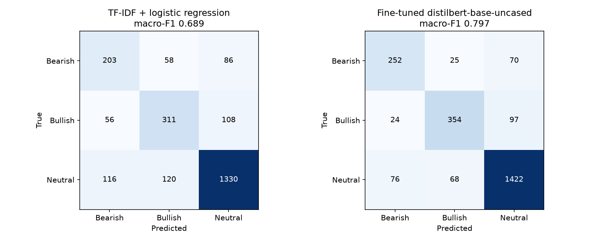

# Financial Sentiment: Fine-Tuning a Transformer vs. a Classic Baseline

Classifies financial news headlines as **Bearish**, **Bullish** or **Neutral**. I fine-tuned DistilBERT and compared it against a TF-IDF + logistic regression baseline, to see how much the transformer actually adds and where both still get it wrong.

Data: the public [Twitter Financial News Sentiment](https://huggingface.co/datasets/zeroshot/twitter-financial-news-sentiment) dataset (~9.5K training and ~2.4K test headlines). Its validation split is the held-out test set, and 10% of the training split is used to pick the best epoch.

## Results

| Model | Accuracy | Macro-F1 | Bearish F1 | Bullish F1 | Neutral F1 |
|---|---|---|---|---|---|
| TF-IDF + logistic regression | 0.772 | 0.689 | 0.562 | 0.645 | 0.861 |
| Fine-tuned DistilBERT | 0.849 | 0.797 | 0.721 | 0.768 | 0.901 |

Trained on 4,000 headlines for 2 epochs (about 6 minutes on an M-series Mac), evaluated on 2,388 held-out headlines. Fine-tuning raised macro-F1 by 0.107.



## What I noticed

- **Bearish headlines improved the most** (F1 0.56 → 0.72), but every one of the model's most confident mistakes was a prediction of Neutral. When it's unsure, it defaults to the majority class.
- **Press-release formatting looks "neutral" to the model.** Headlines like "BPH Energy : Settlement of Litigation #Stock #MarketScreener" were labeled Bullish but predicted Neutral. The template format seems to outweigh the content.
- **Some headlines need financial knowledge, not just language.** "Chegg Reports 2019 Financial Results and Raises 2020 Guidance" is good news only if you know what raising guidance means for a stock.
- **Trader slang and sarcasm get missed.** "$TSLA short 🤣" is clearly bearish to a trader, but the model reads it as neutral.
- **The model is overconfident.** Its top mistakes all have 97–98% confidence, so the confidence scores shouldn't be used as-is, for example to decide which predictions to trust automatically.
- Validation macro-F1 rose from 0.739 after epoch 1 to 0.792 after epoch 2, so a third epoch might still help.

The most confident mistakes are in `output/errors.csv`. Some of them are headlines where I'd argue with the label myself.

## How it works

| File | What it does |
|---|---|
| `sentiment/data.py` | Loads the dataset (or your own CSV) and makes stratified train / validation / test splits |
| `sentiment/baseline.py` | TF-IDF (words + bigrams) with class-balanced logistic regression |
| `sentiment/finetune.py` | Fine-tunes DistilBERT with a plain PyTorch loop: AdamW, warmup + linear decay, gradient clipping, keeps the epoch with the best validation macro-F1 |
| `sentiment/evaluate.py` | Accuracy, macro-F1, per-class precision/recall, confusion matrices, most confident mistakes |
| `sentiment/run.py` | Runs both models and writes `output/report.md`, `results.json`, `confusion_matrices.png`, `errors.csv` |

Macro-F1 is the main metric because the classes are imbalanced (most headlines are Neutral), so accuracy alone would flatter a model that leans Neutral.

## Run

```bash
python3 -m venv .venv && source .venv/bin/activate
pip install -r requirements.txt
python -m sentiment.run                  # 4,000 training headlines, 2 epochs
python -m sentiment.run --train-size 0   # full training set
python -m sentiment.run --epochs 3       # one more epoch
python -m sentiment.run --skip-finetune  # baseline only
python -m unittest discover -s tests -t .
```

Runs on Apple Silicon (MPS), a GPU, or CPU automatically. The first run downloads the model (~270 MB) and the dataset.

## Limitations

- Headlines are short and often ambiguous; some "errors" are labels a human would argue with.
- Trained on a 4,000-headline subset by default to keep runtime reasonable on a laptop.
- No hyperparameter search beyond picking the best epoch.

## Next steps

- Train on the full dataset and with 3 epochs, and compare.
- Try a finance-specific model such as FinBERT.
- Look at whether the model's confidence scores are well calibrated.
- Calibrate the model's confidence (e.g. temperature scaling), since its most confident mistakes are 97%+ sure.
- Try FinBERT, which is pretrained on financial text and may handle phrases like "raises guidance" better.
